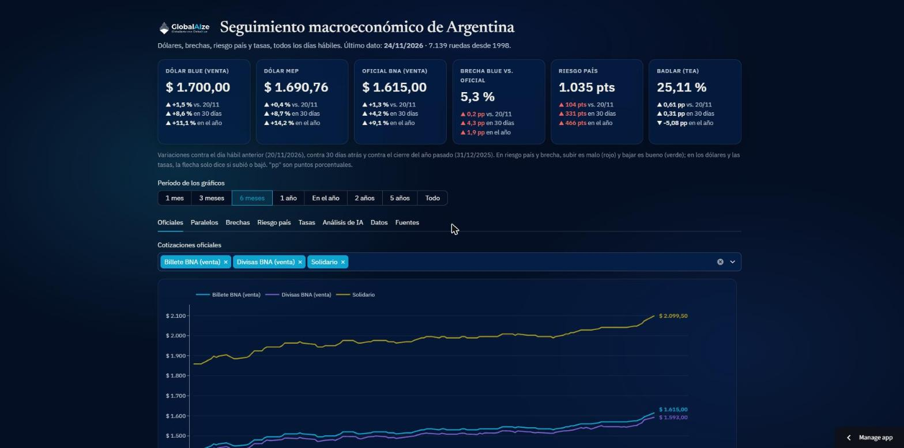
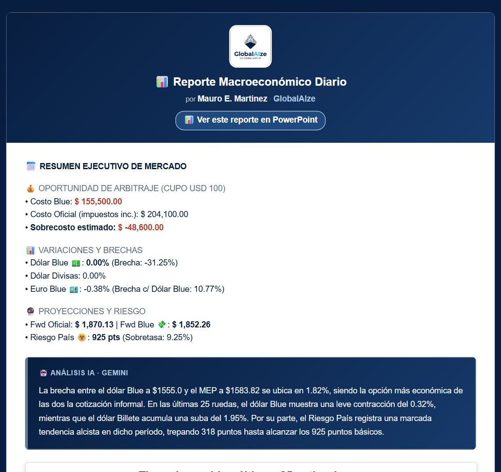
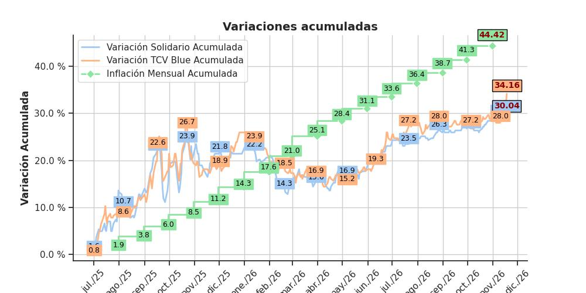
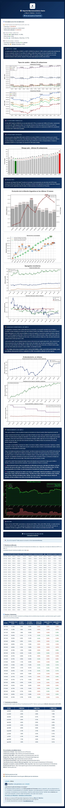
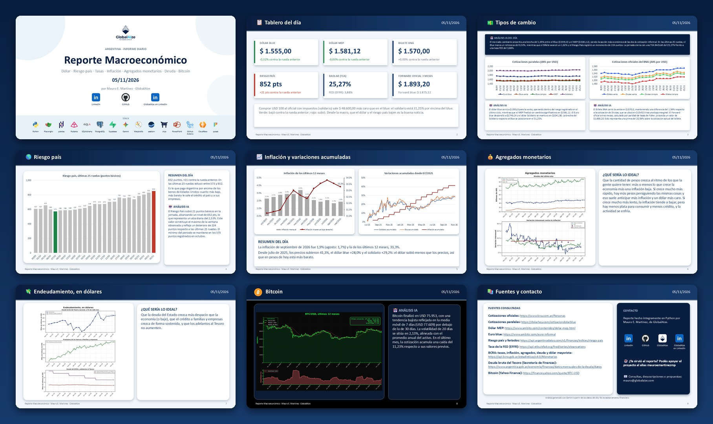
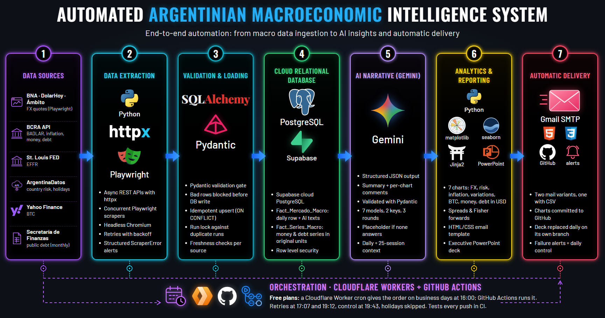
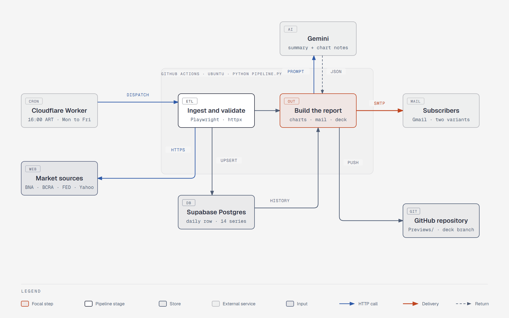
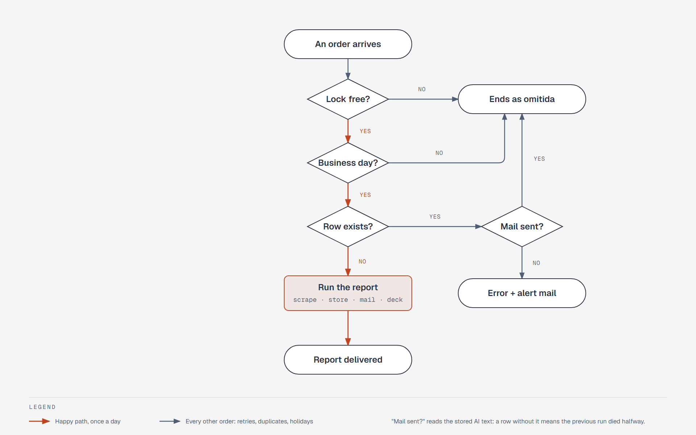

# 🤖 Sistema de reportes y envío automático por mail sobre la macroeconomía argentina, con IA
<p>
  <a href="README.md"></a>
  <a href="README.es.md"></a>
</p>

> **Una infraestructura de Analytics Engineering, pipeline de datos y automatización con IA, diseñada para desenredar, modelar y monitorear de forma sistemática el caos macroeconómico de Argentina, con un reporte que se envía por mail de forma automática.**

[](https://www.python.org)
[](https://playwright.dev)
[](https://www.python-httpx.org)
[](https://pandas.pydata.org)
[](https://supabase.com)
[](https://ai.google.dev/)
[](https://workers.cloudflare.com)
[](https://github.com/features/actions)
[](https://macro-argentina-globalaize.streamlit.app/)

[](https://docs.pydantic.dev)
[](https://www.sqlalchemy.org)
[](https://python-pptx.readthedocs.io)
[](https://github.com/mauroemartinez/RPA-exchange-rate-scraping-automatic-mailing)

[](https://github.com/mauroemartinez/RPA-exchange-rate-scraping-automatic-mailing/actions/workflows/ci.yml)
[](https://github.com/mauroemartinez/RPA-exchange-rate-scraping-automatic-mailing/commits/main)
[](https://github.com/mauroemartinez/RPA-exchange-rate-scraping-automatic-mailing)
[](https://github.com/mauroemartinez/RPA-exchange-rate-scraping-automatic-mailing)

<p align="left">
  <a href="#-qu%C3%A9-llega-a-la-casilla-cada-d%C3%ADa-h%C3%A1bil">📬 El mail</a> ·
  <a href="#-la-presentaci%C3%B3n-ejecutiva-de-hoy">📊 La presentación de hoy</a> ·
  <a href="#%EF%B8%8F-arquitectura-del-sistema-y-dise%C3%B1o-del-pipeline-de-datos">🏗️ Arquitectura</a> ·
  <a href="#%EF%B8%8F-c%C3%B3mo-es-la-corrida-de-cada-d%C3%ADa">⚙️ La corrida de cada día</a> ·
  <a href="#-fuentes-de-datos">🌐 Fuentes</a> ·
  <a href="#-herramientas-operativas">🛟 Operación</a> ·
  <a href="#-evoluci%C3%B3n-del-proyecto-e-hitos-hist%C3%B3ricos">🧭 Historia</a>
</p>

---

## 📈 Tablero online

**[macro-argentina-globalaize.streamlit.app](https://macro-argentina-globalaize.streamlit.app/)**: los mismos datos del mail, para explorarlos por tu cuenta. Dólares oficiales y paralelos, brechas, riesgo país, tasas y el análisis de IA, cada tema en su pestaña con su propio filtro, y cada variación dice contra qué fecha se compara. Se actualiza todos los días hábiles con un workflow chico (`datos-dashboard.yml`) que copia los datos a `dashboard/data/mercado.csv`, así el tablero publicado no necesita credenciales.

<p align="center"></p>

En el plan gratis de Streamlit la app se duerme si nadie la usa: la primera visita puede tardar unos segundos en despertarla.

---

## 📬 Qué llega a la casilla cada día hábil

A las 16:00, hora de Argentina, una lista privada de suscriptores recibe un único mail en HTML: los tipos de cambio oficiales y paralelos del día con sus brechas, el riesgo país, la inflación, las proyecciones forward de Irving Fisher, Bitcoin, los agregados monetarios y la deuda pública y privada de Argentina en dólares. Gemini redacta el análisis; Python calcula cada número que cita.

<p align="center">
  
</p>

| | |
|:---|:---|
| **Tipos de cambio, últimas 25 ruedas**<br>paneles paralelo y oficial, con el comentario de Gemini debajo de cada uno<br> | **Riesgo país, últimas 25 ruedas**<br>barras diarias con el máximo y el mínimo del período, y su propio comentario de la IA<br> |
| **Inflación, mensual e interanual**<br>los últimos doce meses, con la acumulada de dos, tres y doce meses<br> | **Variaciones acumuladas desde julio de 2025**<br>blue, oficial, MEP e inflación en el mismo eje<br> |
| **Agregados monetarios**<br>base, M2 y M3 frente a la inflación, con una explicación en lenguaje simple<br> | **Deuda pública y privada, siempre en USD**<br>deuda bruta del Tesoro, préstamos bancarios, letras y adelantos del BCRA<br> |
| **Bitcoin**<br>precio, volatilidad y medias móviles, con su propio comentario de la IA<br> | **En números**<br><br>7 gráficos, rearmados en cada corrida<br>5 textos de IA por día, de una sola llamada estructurada a Gemini<br>14 series macro guardadas con sus fechas y unidades de origen<br>9 diapositivas en la presentación ejecutiva, reemplazada a diario<br>2 variantes del mail, con y sin el historial en CSV<br>260+ tests offline, que corren en cada push |

Los gráficos de arriba son los reales: el pipeline los sube con un commit a `Previews/` después de cada corrida, así que esta página siempre muestra el último reporte.

<details>
<summary><b>Ver el mail completo, de punta a punta</b></summary>
<p align="center">
  
</p>
</details>

---

## 📊 La presentación ejecutiva de hoy
El pipeline rearma todos los días hábiles una presentación de PowerPoint de nueve diapositivas y conserva solo la última, en la rama [`reporte-ejecutivo`](https://github.com/mauroemartinez/RPA-exchange-rate-scraping-automatic-mailing/tree/reporte-ejecutivo).

<p align="center">
  <a href="https://view.officeapps.live.com/op/view.aspx?src=https%3A%2F%2Fraw.githubusercontent.com%2Fmauroemartinez%2FRPA-exchange-rate-scraping-automatic-mailing%2Freporte-ejecutivo%2FReporte%2520Ejecutivo.pptx">
    
  </a>
</p>

**[▶️ Ver online la presentación de hoy](https://view.officeapps.live.com/op/view.aspx?src=https%3A%2F%2Fraw.githubusercontent.com%2Fmauroemartinez%2FRPA-exchange-rate-scraping-automatic-mailing%2Freporte-ejecutivo%2FReporte%2520Ejecutivo.pptx)** · [⬇️ Descargar el .pptx](https://github.com/mauroemartinez/RPA-exchange-rate-scraping-automatic-mailing/raw/reporte-ejecutivo/Reporte%20Ejecutivo.pptx)

---

## 🏗️ Arquitectura del sistema y diseño del pipeline de datos
Abajo está el diagrama de punta a punta del ciclo de vida de los datos en producción.

<p align="center">
  
</p>

El diagrama se genera desde `Assets/arquitectura/construir.py`, así que se puede actualizar sin redibujarlo.

Dos vistas más de cerca, dibujadas con las convenciones de [diagram-design](https://github.com/cathrynlavery/diagram-design) (fuentes en `Assets/diagramas/`, un HTML por diagrama, en versión clara y oscura):

<p align="center">
  <picture>
    <source srcset="Assets/diagramas/arquitectura-dark.png" media="(prefers-color-scheme: dark)">
    
  </picture>
</p>

<p align="center">
  <picture>
    <source srcset="Assets/diagramas/control-de-la-corrida-dark.png" media="(prefers-color-scheme: dark)">
    
  </picture>
</p>

---

## ⚙️ Cómo es la corrida de cada día

`pipeline.py` corre doce etapas en orden. Cada una registra su estado (`ok`, `advertencia`, `error` u `omitida`) y su duración; cualquier etapa con error pone la corrida en rojo (exit code 1) y manda un único mail de alerta con el resumen.

| # | Etapa | Qué hace | Si falla |
|:-:|---|---|---|
| 1 | 🔒 **control** | Toma un advisory lock de Postgres, saltea los fines de semana y los feriados nacionales, y rechaza una corrida programada que arranque antes de las 14:00 (un cron atrasado que pasó la medianoche) | La corrida termina como `omitida` |
| 2 | 🗄️ **historico** | Lee todo el histórico desde Supabase (con el CSV como respaldo) y detecta un día ya hecho, o hecho a medias | Error y alerta si la corrida anterior murió a mitad de camino |
| 3 | 🕷️ **scraping** | Seis fuentes a la vez: tres navegadores con Playwright y tres llamadas REST que comparten un mismo `asyncio.gather()` | Alerta y se frena |
| 4 | ✅ **validacion** | Arma la fila de hoy y la valida con Pydantic y contra los últimos valores guardados (un precio que se mueve más de 5x es una coma decimal mal leída) antes de persistir nada | Alerta y se frena |
| 5 | 💾 **persistencia** | Un único `INSERT ... ON CONFLICT ("Fecha")` atómico; si mientras tanto apareció la fila, la corrida se frena como `omitida` | Nunca hay un mail duplicado |
| 6 | 🧠 **ia** | Una llamada estructurada a Gemini: el resumen más un comentario por gráfico, validados con Pydantic; siete modelos, del mejor al peor, las dos claves, hasta tres rondas | El mail sale con un texto provisorio y la fila queda marcada como hecha sin IA |
| 7 | 📈 **indicadores** | Dos años de series del BCRA y el Excel de deuda bruta del Tesoro, cada serie validada por separado | Advertencia; el mail sale sin ese gráfico |
| 8 | 🎨 **graficos** | Los siete gráficos, cada uno en su propia figura de Matplotlib; los tipos de cambio y el riesgo país van en imágenes separadas; Bitcoin, desde Yahoo Finance | Advertencia; el mail sale sin Bitcoin |
| 9 | 📧 **mail** | Renderiza la plantilla Jinja2 y manda las dos variantes en paralelo, con y sin el historial en CSV | La corrida falla |
| 10 | 📊 **presentacion** | Arma la presentación ejecutiva de nueve diapositivas con los mismos datos en memoria | Advertencia; el mail ya salió |
| 11 | 🔁 **previews** | Sube con un commit los siete gráficos a `Previews/` en `main` y publica la presentación como único commit de su rama | Advertencia |
| 12 | 🧮 **series** | Hace un upsert de las series descargadas en `Fact_Series_Macro` y reescribe solo los valores que cambiaron | Advertencia |

---

## 🌐 Fuentes de datos

| Fuente | Qué aporta | Cómo |
|---|---|---|
| Banco Nación | Tipo de cambio minorista, billete y divisa (compra y venta) | Playwright |
| DolarHoy | Dólar paralelo ("blue") | Playwright |
| Ámbito | Dólar MEP y euro blue | Playwright |
| ArgentinaDatos | Riesgo país con su fecha de publicación; feriados nacionales | REST |
| API de estadísticas del BCRA | Tasa BADLAR, inflación mensual e interanual, agregados monetarios, letras, adelantos transitorios, préstamos al sector privado, tipo de cambio mayorista A3500 | REST, paginada |
| St. Louis FRED | Tasa efectiva de los fondos federales, para los forwards de Fisher; cuando FRED falla, la misma tasa sale de la Fed de Nueva York, que la publica | REST |
| Secretaría de Finanzas | La deuda bruta del Tesoro, en un Excel mensual que se lee por etiquetas y con los meses provisorios marcados | HTTP + openpyxl |
| Yahoo Finance | Bitcoin en USD | yfinance |
| Google Gemini | El resumen y los comentarios por gráfico, con failover entre varias claves y varios modelos | Salida JSON estructurada |

Cada valor se guarda en la unidad de su fuente y con la fecha de su fuente; la conversión a USD se hace solo para mostrarlo.

---

## 🗄️ Los datos históricos

`Fact_Mercado_Macro` tiene una fila por día hábil desde diciembre de 1998 (7.116 filas en octubre de 2026). Los años anteriores a octubre de 2022 salieron de una carga masiva desde una planilla; desde entonces, cada fila se obtiene por scraping. En octubre de 2026 se auditó toda la tabla contra los archivos históricos de las mismas fuentes que leen los scrapers, y se corrigieron 26.019 celdas, cada pasada dentro de una única transacción y después de una copia completa de la tabla (`scripts/depurar_historico.py`, ver [Herramientas operativas](#-herramientas-operativas)).

| Columna | Datos reales desde | De dónde sale el histórico |
|---|---|---|
| Blue, venta | enero de 2002 | El archivo propio de DolarHoy desde 2011; antes, el de Ámbito (de 2011 a 2020 los dos son idénticos, día por día). Antes de 2002 no había mercado paralelo: un peso era un dólar |
| Blue, compra | enero de 2002 | El archivo de DolarHoy no tiene precio de compra: sale de Ámbito o de ArgentinaDatos los días en que su precio de venta coincide con el de DolarHoy, así cada par tiene una sola fuente. Los días en que ninguno coincide quedan vacíos |
| Billete, compra y venta | enero de 2003 | El archivo propio del Banco Nación, al centavo |
| Divisas, MEP | octubre de 2022 | Scraping diario, contrastado con el A3500 del BCRA y con ArgentinaDatos |
| Solidario | diciembre de 2019 | El dólar tarjeta de ArgentinaDatos para los años de la carga masiva; desde que hay scraping, el billete multiplicado por el recargo vigente (1,3 desde 2025) |
| Riesgo país | diciembre de 1998 | Completo |
| Euro blue | abril de 2023 | Ámbito, la fuente del scraper, que lo publica desde junio de 2023 |
| Tasas FED y BADLAR | mayo de 2023 | La EFFR de la Fed de Nueva York y el BCRA |

Qué corrigió la auditoría:

| Problema | Ejemplo | Cómo se confirmó |
|---|---|---|
| Valores de relleno de la carga masiva | El blue en 292, el solidario en 275,55 y el euro en 455 durante más de 6.000 días | El mismo valor durante cientos de días mientras todas las fuentes se movían. Se conservó el último día de cada racha, que es el primero real |
| Un cero perdido después de la coma decimal | Billete 3,08 guardado como 38, 18,05 como 185 (2003 a 2017) | Los dígitos guardados son exactamente la cifra del Banco Nación para ese día, sin el cero |
| Coma decimal corrida | Billete 3,155 como 3155, MEP 1.460,5 como 14.605, solidario hasta 10^10 veces | Una potencia exacta de 10 respecto de la fuente; el solidario, contra el billete de ese día multiplicado por su recargo |
| Día y mes invertidos | Las filas del 11 de enero, febrero, marzo, abril, julio, agosto y octubre de 2022 tenían el billete del 1 al 10 de noviembre de 2022 | Sus valores son idénticos a los de la fecha con el día y el mes invertidos, y el Banco Nación dice otra cosa para ese día |
| Valores congelados | El blue clavado en 1.520/1.540 del 7 de agosto al 8 de septiembre de 2026; el euro clavado de mayo a julio de 2026 | La fuente se movía y el valor guardado no. Ámbito no publicó euro blue entre el 6 de mayo y el 14 de julio de 2026: esos días quedan vacíos. Un valor que no se mueve mientras su base tampoco se mueve no está congelado: del 14 de agosto al 15 de noviembre de 2023 el oficial estuvo fijo, y el solidario también |
| Tasa FED errónea | 58 % en lugar de 5,08 % (2023 a 2025) | La EFFR de la Fed de Nueva York para ese día |
| Compra por encima de la venta | El euro del 29 de enero de 2024 | Se reemplazó por el par de la fuente para ese día |

Donde no hay fuente, la celda queda vacía en lugar de tener un número inventado. Las diferencias intradiarias contra los archivos (el scraper lee a las 16:00 y los archivos guardan el cierre) son lecturas reales y quedaron como estaban. Dos controles evitan que estos errores vuelvan: la corrida diaria frena cualquier precio que se mueva más de cinco veces respecto del último guardado, y cada fecha se parsea con su formato explícito, porque `pd.to_datetime("01/11/2022")` sin formato lo lee como 11 de enero.

---

## 📋 Descripción general del proyecto

Este repositorio contiene un pipeline robusto de automatización robótica de procesos (RPA) e ingeniería de datos, con nivel de portfolio, pensado para seguir, almacenar y analizar el complejo panorama económico y cambiario argentino.

El sistema automatiza la ingesta de variables financieras muy volátiles, asegura la integridad de los datos en un data warehouse centralizado, corre proyecciones macro matemáticas y distribuye reportes financieros dinámicos, con un diseño muy cuidado, a una lista privada de suscriptores. Los mismos datos alimentan una presentación ejecutiva en PowerPoint. Toda la corrida funciona sin intervención: un cron de un Cloudflare Worker da la orden y GitHub Actions la ejecuta, los dos en planes gratuitos.

### 🛠️ Stack tecnológico y frameworks principales
* **Ingesta de datos (ETL):** httpx (APIs REST), Playwright (web scraping asíncrono), openpyxl (el Excel mensual de deuda del Tesoro), yfinance (Bitcoin), tenacity (reintentos con espera creciente).
* **Procesamiento y mapeo relacional:** Pandas (manipulación de datos), SQLAlchemy (ORM).
* **Validación de datos:** Pydantic, para una validación estricta del esquema antes de persistir los datos.
* **Gestión de la configuración:** Pydantic-Settings, para una configuración de entorno tipada que falla rápido.
* **Data warehouse:** **Supabase PostgreSQL** para analítica y persistencia en la nube. Antes de Supabase usé Microsoft SQL Server 2022 y Microsoft SQL Server 2019.
* **IA generativa:** modelos Google Gemini Flash con salida JSON estructurada, validada con Pydantic, con failover entre claves y entre modelos (generación de una narrativa macro contextual).
* **Visualización y entrega de datos:** Matplotlib, Seaborn, plantillas HTML/CSS con Jinja2, tabulate, python-pptx (presentación ejecutiva), servicio SMTP.
* **Tablero online:** Streamlit + Plotly (`dashboard/app.py`), publicado en Streamlit Community Cloud; un workflow diario de GitHub Actions (`datos-dashboard.yml`) actualiza sus CSV, así que no necesita credenciales.
* **Orquestación y CI:** un Cloudflare Worker (cron triggers, plan gratuito) dispara la corrida diaria y el control diario a horario exacto; GitHub Actions (plan gratuito) los ejecuta y corre la suite de tests en cada push. Las dependencias se fijan con uv a partir de manifiestos `.in`; ruff revisa el código en cada push.

---

## 📁 Estructura del repositorio

```
├── pipeline.py              Punto de entrada: la corrida diaria y su CLI (etapas, resultados por etapa, alertas)
├── reporte/                 El reporte en sí, como paquete de Python
│   ├── config.py            Configuración de entorno tipada (Pydantic-Settings)
│   ├── models.py            Esquema de validación por fila (Pydantic) y el esquema de la respuesta de la IA
│   ├── data_access.py       Lecturas de Supabase, insert idempotente, lock de la corrida, upsert de series
│   ├── transformations.py   La fila de hoy, validación, brechas, forwards de Fisher, inflación
│   ├── charts.py            Los siete gráficos del reporte
│   ├── indicadores.py       Explicaciones en lenguaje simple de los gráficos de agregados y deuda
│   ├── ia_generator.py      Capa de narrativa con Gemini
│   ├── email_report.py      Renderizado del HTML, armado del MIME y envío
│   ├── mailer.py            Envío por SMTP y alertas de falla
│   ├── presentacion.py      La presentación ejecutiva diaria en PowerPoint
│   ├── graficos_pptx.py     Sus gráficos nativos de PowerPoint (tipo de cambio, riesgo país, inflación, variaciones)
│   ├── preview_git.py       Commit de Previews/ y publicación de la rama de la presentación
│   ├── fechas.py            Fechas en hora de Argentina y nombres de los meses en español
│   ├── scrapers/            Capa de ingesta: scrapers con Playwright + clientes REST asíncronos
│   └── templates/           Plantillas Jinja2: el mail y el reporte macro en PDF
├── scripts/                 Herramientas operativas (reenvío manual, control diario, presentación y reporte PDF a mano)
├── tests/                   Suite de tests offline; tests/datos/ fija el HTML del mail
├── sql/                     SQL aplicado a mano en Supabase: esquema, migraciones, limpieza
├── notebooks/               El laboratorio SQL de solo lectura
├── dashboard/               Tablero de Streamlit publicado (Streamlit Community Cloud), de solo lectura, con sus propios requirements
├── Assets/                  Diagrama de arquitectura, imágenes del README y sus generadores
├── Previews/                Gráficos diarios, subidos automáticamente por el pipeline
├── .github/workflows/       CI, la corrida diaria, el control diario y la actualización de datos del tablero
├── cloudflare/              El Worker que dispara la corrida en horario (wrangler.toml + disparador.js)
├── pyproject.toml           Configuración de pytest y ruff
└── requirements*.in / .txt  Dependencias directas, fijadas en el .txt correspondiente
```

---

## 🛟 Herramientas operativas

**Corrida diaria.** `pipeline.py` es todo el reporte de punta a punta, el mismo código que corre GitHub Actions:

```bash
python pipeline.py --dry-run                          # scraping en vivo, no escribe ni manda nada
python pipeline.py --dry-run --enviar-a me@mail.com   # lo mismo, pero el reporte me llega solo a mí
python pipeline.py                                    # la corrida real
```

Una corrida de prueba deja en una carpeta temporal los siete gráficos, la presentación ejecutiva, una vista previa para el navegador y un `.eml` del reporte. El exit code es 1 cuando falla cualquier etapa, así los programadores de tareas pueden alertar. Otras opciones: `--sin-mail`, `--sin-push`, `--forzar` (rehacer un día), `--desde HH:MM` (rechazar una corrida que arranque antes, para crons atrasados), `--json FILE`.

**Programación.** La corrida en sí ocurre en GitHub Actions. La orden viene de un Cloudflare Worker (`cloudflare/`, plan gratuito): sus cron triggers mandan un `workflow_dispatch` a las 16:03 hora de Argentina, de lunes a viernes, lo repiten a las 16:37, 17:37 y 19:33 (un día ya terminado cierra como `omitida` en un minuto, así que una fuente que vuelve se recupera media hora después) y piden el control diario a las 21:12; un dispatch arranca en segundos. Los cron propios de GitHub siguen en los workflows, se prenden y se apagan con la variable de repositorio `CORRIDA_AUTOMATICA`, y están apagados: en el plan gratuito llegaban con horas de atraso, y una vez pasaron la medianoche.

**Presentación ejecutiva.** Sus gráficos de tipo de cambio, riesgo país, inflación y variaciones son gráficos nativos de PowerPoint: nítidos en cualquier tamaño, se les puede cambiar el estilo, y "Editar datos" abre los números del día. Los números de los ejes y los nombres de los meses siguen la configuración regional de quien abre el archivo, así que el mismo archivo muestra `1.500` en Argentina y `1,500` en un sistema en inglés. La última presentación está siempre en [`Reporte Ejecutivo.pptx`](https://github.com/mauroemartinez/RPA-exchange-rate-scraping-automatic-mailing/raw/reporte-ejecutivo/Reporte%20Ejecutivo.pptx), en la rama `reporte-ejecutivo`. Esa rama se reconstruye todos los días como un único commit, así que nunca acumula versiones. `python scripts/presentacion_ejecutiva.py` arma la misma presentación a mano desde el warehouse.

**Migraciones de Supabase.** `sql/` contiene el SQL aplicado a mano en el SQL Editor de Supabase; los dos archivos son idempotentes y ya están aplicados:

* `06_series_macro.sql` crea `Fact_Series_Macro`, una tabla en formato largo para las series de agregados monetarios, inflación y deuda, cada una en su unidad de origen. `python scripts/agregados_monetarios.py --guardar` carga todo su histórico, y la corrida diaria las mantiene al día.
* `07_ai_paragraphs.sql` agrega la columna `ai_secciones` al lado de `ai_paragraph`: los comentarios de la IA por gráfico, en JSON, con el modelo que los escribió.

**Depuración del histórico.** `python scripts/depurar_historico.py` audita `Fact_Mercado_Macro` contra los archivos de las propias fuentes de los scrapers (Banco Nación, DolarHoy, Ámbito), más ArgentinaDatos, el BCRA y la Fed de Nueva York, y lista cada celda que corregiría, con su motivo: valores de relleno de la carga masiva, comas decimales mal leídas, día y mes invertidos, valores congelados, precios de compra faltantes y pares imposibles, con la compra por encima de la venta. No se escribe nada sin `--aplicar`, que primero guarda una copia completa de la tabla. Se corrió en octubre de 2026; si se vuelve a correr, no encuentra nada para corregir.

**Control diario.** `python scripts/control_diario.py` falla y manda una alerta cuando un día hábil termina sin su fila en el warehouse, lo que detecta la corrida que nunca arrancó. Con `--sin-alerta` solo informa.

**Tests.** `pytest` corre una suite offline que nunca toca la red, el warehouse ni el SMTP: credenciales falsas pisan cualquier `.env` real, y un test que intenta mandar un mail, hacer un request HTTP, descargar datos de mercado o abrir un navegador falla en el acto. Un test de golden file fija el HTML del reporte byte por byte. `ruff check .` pasa el linter por todo el código.

Los scripts de `scripts/` corren por separado del pipeline diario, para las situaciones que la programación automática no cubre.

**Reenvío manual.** Manda el reporte más reciente a los destinatarios que se le indiquen, para suscriptores que se suman a mitad de mes o que nunca recibieron el mail:

```bash
python scripts/reenvio_manual.py someone@mail.com
python scripts/reenvio_manual.py one@mail.com another@mail.com
python scripts/reenvio_manual.py someone@mail.com --csv       # adjunta el CSV de seguimiento
python scripts/reenvio_manual.py someone@mail.com --dry-run   # lo arma, no manda nada
```

Reproduce la corrida diaria en lugar de repetirla: sin scraping, sin validación de filas, sin escrituras en el warehouse, sin llamada a Gemini y sin git push. El reporte se rearma a partir de la fila más nueva de `Fact_Mercado_Macro`, los textos de IA ya guardados en ella y los gráficos de `Previews/`, con el mismo módulo de renderizado que la corrida diaria, así que su HTML coincide con el del mail diario salvo por la línea de tiempos de ejecución. Las oraciones debajo de los gráficos de agregados y deuda se recalculan con los últimos datos publicados. Un único destinatario va en Para; si son varios, van en CCO. El script se interrumpe si la última fila no tiene párrafo de IA, lo que significa que el pipeline no terminó o que Gemini no devolvió nada ese día. Con la corrida diaria en GitHub Actions, hay que hacer `git pull` antes de un reenvío: lee los gráficos del `Previews/` local y deja afuera los que sean más viejos que el reporte.

---

## 🚀 Estado de la hoja de ruta

La hoja de ruta de seis fases está completa. Lo que dejó cada fase en producción, y lo que sigue abierto:

| Fase | Estado | En producción |
|---|:-:|---|
| 1. Pipeline sin el notebook | ✅ | `pipeline.py` con su CLI y el paquete `reporte/`; el notebook, retirado |
| 2. Confiabilidad y diagnóstico | ✅ | Estado y duración por etapa, los envíos fallidos ponen la corrida en rojo, 260+ tests offline, HTML golden, secretos borrados de los logs públicos. Se evaluó cachear las APIs y se descartó: nada es lo bastante pesado |
| 3. Agregados monetarios y deuda | ✅ | `Fact_Series_Macro` con 14 series, dos gráficos en el mail con explicaciones en lenguaje simple, deuda siempre en USD |
| 4. Comentarios de IA por gráfico | ✅ | Una llamada estructurada a Gemini, validada con Pydantic y guardada como JSON; recorre siete modelos y las dos claves antes de darse por vencida |
| 5. Análisis y presentaciones | ✅ | Laboratorio SQL de solo lectura, la presentación ejecutiva diaria, el reporte macro en PDF. Dashboard en Streamlit, publicado en Streamlit Community Cloud y alimentado por CSV diarios (sin credenciales de la base) |
| 6. Programación y monitoreo | ✅ | Corrida en GitHub Actions, lock de Postgres, calendario de feriados, ventana horaria, control diario, CI en cada push, un Cloudflare Worker como disparador |

Pendiente: la fecha de inicio del gráfico de variaciones, fija en `charts.py` y que ya toca mover.

---

## 🧭 Evolución del proyecto e hitos históricos

<details>
<summary><b>De un único script de scraping en 2022 al pipeline de hoy, hito por hito</b></summary>

Desde su inicio en 2022, esta infraestructura pasó de ser un único script de scraping a un sistema analítico de varias capas, saldando deuda técnica de forma sistemática y ampliando la cobertura de datos:

* **El origen y el núcleo de ingesta (2022):** Desarrollé la capa base de web scraping para capturar tipos de cambio no estructurados y muy volátiles desde portales dinámicos (DolarHoy, Banco Nación), lo que resolvió los cuellos de botella de la carga manual en la documentación de operaciones de comercio exterior.
* **Consolidación del pipeline:** Unifiqué flujos de datos dispersos y heterogéneos en estructuras uniformes de Pandas. Desarrollé el script central de envío automático de mails para distribuir las estructuras analíticas sin fricción.
* **Capa de visualización y analítica avanzada:** Implementé pipelines de visualización con Matplotlib y Seaborn, resolviendo el formato de series de tiempo complejas. Sumé capas financieras calculadas, como brechas, métricas de variación e indicadores de rendimiento.
* **Refactorización de la presentación:** Incorporé formato dinámico con HTML5 (2023) y CSS3 semántico (2025) para reemplazar las salidas en texto plano, con la biblioteca `tabulate` para asegurar matrices de datos robustas y responsivas en distintos tamaños de pantalla.
* **Ampliación de los indicadores macro:** Amplié el alcance de la ingesta para seguir el riesgo país soberano, las tasas de interés del banco central y series históricas de varios niveles (BNA, MEP). Integré las tasas de la Reserva Federal para hacer proyecciones de tasas forward basadas en la hipótesis de *Irving Fisher*.
* **Arquitectura relacional empresarial (2025-2026):** Dejé atrás la persistencia en archivos planos y pasé a un modelo de data warehouse permanente sobre **Microsoft SQL Server 2022**. Desarrollé mecanismos de upsert robustos con **SQLAlchemy** para garantizar una integridad de datos estricta y eliminar los registros duplicados.
* **Hito de migración a la nube:** Migré con éxito el data warehouse de **SQL Server 2022 a Supabase PostgreSQL**, y así completé la transición planificada a la analítica en la nube.
* **Control de validación con Pydantic (2026):** Empecé a validar las filas macro entrantes con **Pydantic** antes de persistir registros nuevos. Cuando un scraper produce valores inválidos o sospechosos, la escritura se bloquea y el problema queda a la vista del desarrollador para que lo corrija, lo que impide que datos erróneos lleguen al warehouse.
* **Sincronización automática de las previews en el repositorio (2026):** Implementé flujos automáticos de versionado con Git directamente desde la capa de orquestación en Python. El sistema ahora detecta los gráficos modificados dentro del directorio `/Previews` y hace solo los commits y el push a GitHub, de modo que el repositorio siempre refleja los últimos resultados analíticos generados, sin intervención manual.
* **Capa de narrativa con IA generativa (2026):** Puse en producción un módulo de insights con IA, apto para producción, basado en **Google Gemini 2.5 Flash**. El motor consulta el data warehouse en SQL Server, calcula las variaciones diarias y las móviles de 25 ruedas de todos los indicadores macro clave (tipos de cambio, riesgo país, tasas efectivas del BCRA y de la FED) y arma de forma dinámica un párrafo de narrativa financiera contextualizada que se inserta directamente en el reporte HTML del mail. El módulo tiene lógica de failover entre varias API keys, con rotación automática cuando se agota la cuota (HTTP 429), guarda el texto generado en el data warehouse con un `UPDATE` para poder auditarlo a lo largo del tiempo, y está totalmente desacoplado de la capa de orquestación como un módulo `ia_generator` independiente.
* **Hito de threading (2026):** Sumé threading para que las dos variantes del mail (con y sin el CSV adjunto) se manden en paralelo. Esto reduce bastante el tiempo total de envío, ya que la entrega de los mails es la parte más pesada del proyecto.
* **Optimización del rendimiento del scraping (2026):** Reemplacé el ciclo de vida del navegador por request (abrir → scrapear → cerrar, repetido para cada sitio) por una única instancia persistente de WebDriver compartida entre todos los scrapers. Esto eliminó el costo redundante de arrancar el navegador y redujo el tiempo total de scraping en ~50 %.
* **Modernización del cliente HTTP (2026):** Migré de `requests` a `httpx` todas las llamadas a APIs REST (BCRA, St. Louis FED). `httpx` es el estándar moderno: ofrece soporte async nativo y compatibilidad con HTTP/2, con una API totalmente compatible.
* **Gestión automática de la versión del WebDriver (2026):** Reemplacé el binario `msedgedriver`, que se mantenía a mano, por `webdriver-manager`. La librería detecta sola la versión de Edge instalada, descarga el driver correspondiente en la primera ejecución y lo guarda en caché localmente, lo que elimina las actualizaciones manuales cada vez que se actualiza el navegador.
* **Migración de Selenium a Playwright (2026):** Migré toda la capa de web scraping (BNA, DolarHoy, Ámbito MEP/riesgo país/euro) de Selenium a la API async de Playwright, y reemplacé cadenas de XPath largas y frágiles por selectores CSS o por id, cortos y semánticos. Los cuatro scrapers ahora corren en simultáneo con `asyncio.gather()`, en lugar de uno tras otro a través de un único WebDriver compartido, lo que reduce todavía más el tiempo total de scraping. Ante una falla, cada scraper lanza un `ScraperError` estructurado con el contexto del sitio y del paso, así que un selector roto falla de forma visible a través del control de validación con Pydantic que ya existía, en lugar de persistir datos erróneos en silencio. Esto también unificó el manejo del navegador entre el desarrollo local en Windows y el entorno productivo en Docker, y eliminó la bifurcación anterior entre Edge y Chromium en la configuración del driver.
* **Plantillas Jinja2 para el reporte por mail (2026):** Saqué el HTML/CSS del reporte del script de orquestación en Python y lo pasé a una plantilla Jinja2 independiente, `reporte/templates/report_email.html`, en reemplazo de un f-string inline enorme. El notebook ahora solo calcula los valores y renderiza la plantilla; el markup, los estilos y la media query responsiva para celulares viven en un archivo dedicado y legible, en lugar de estar mezclados con la lógica de negocio.
* **Capa de configuración centralizada (2026):** Reemplacé las llamadas a `os.getenv` dispersas entre el notebook, `app.py` y `reporte/ia_generator.py` por un único `reporte/config.py` basado en **Pydantic-Settings**. Cada variable de entorno ahora se declara una sola vez y con un tipo estricto: los secretos usan `SecretStr` (enmascarados al imprimirse; leerlos requiere un `.get_secret_value()` explícito), las listas de destinatarios se parsean y se validan dirección por dirección con `EmailStr`, y las rutas del sistema de archivos se resuelven como objetos `Path`. Una variable faltante o mal formada ahora falla al importar, en lugar de aparecer como un `None` en lo profundo del pipeline. Se sumó, además, un `.env.example` versionado que documenta cada clave requerida.
* **Migración del riesgo país a una API (2026):** Reemplacé el scraping con Playwright de la tabla histórica de riesgo país de Ámbito por la **API REST de ArgentinaDatos**, que expone la misma fuente subyacente en JSON. Así se evita levantar un Chromium completo para leer una sola celda de una tabla. El módulo nuevo es totalmente async (`httpx.AsyncClient`) y devuelve el valor junto con su fecha real de publicación.
* **Capa de ingesta HTTP totalmente async (2026):** Saqué del notebook las llamadas a las APIs del BCRA y de la FED de St. Louis y las pasé a módulos dedicados, `reporte/scrapers/bcra.py` y `reporte/scrapers/fed.py`, con `httpx` async. Las seis fuentes, tres navegadores con Playwright y tres APIs REST, ahora se ejecutan dentro de un único `asyncio.gather()` que comparte un mismo pool de conexiones. Las tres llamadas a APIs, que antes eran secuenciales y bloqueaban el inicio del scraping, ahora corren durante la espera ociosa de los navegadores: **el tiempo total de ingesta bajó de 22,8 s a 18,3 s, aun con dos fuentes más**. La política de reintentos distingue las fallas transitorias (5xx, red) de las permanentes (4xx) y aplica backoff exponencial.
* **Auditoría de integridad de datos y recarga del histórico (2026):** Una comparación sistemática del warehouse contra sus APIs de origen sacó a la luz dos defectos de captura silenciosos. El **riesgo país** estaba corrido un día hábil: el scraper leía el último cierre *publicado* de Ámbito y lo guardaba con la fecha actual; 160 de las 171 filas divergentes coincidían exactamente con el día hábil anterior. La **tasa efectiva anual del BCRA** leía `.iloc[-1]` sobre una respuesta de la API ordenada de forma descendente, con lo que persistía el registro más viejo de una ventana de 1000 puntos: una tasa de junio de 2022 guardada como actual, que se propagaba a la narrativa de la IA y a las proyecciones de tasas forward de Irving Fisher. Se corrigieron 936 filas contra la fuente; las dos series ahora concilian al 100 %. Los dos módulos ahora ordenan de forma explícita y exponen la fecha real de publicación del valor, con avisos de desactualización en tiempo de ejecución.
* **Alertas ante fallas del scraper (2026):** Sumé un módulo independiente, `reporte/mailer.py`, que convierte un `ScraperError` en un mail de alerta en texto plano con la fuente, el paso que falló, la causa raíz y el traceback. Envuelve la llamada de ingesta para que un selector roto o una API caída le avisen a quien mantiene el sistema antes de que la corrida se interrumpa, y así se cerró el hueco por el que las fallas morían en silencio en un proceso desatendido. El camino de alerta nunca lanza excepciones: si el servidor SMTP no responde, se degrada a una advertencia por consola en lugar de tapar la falla original.
* **Verificación TLS restablecida (2026):** La integración con la API del BCRA tenía `verify=False`, que desactivaba la validación de certificados para esquivar una cadena rota del lado del banco. Se verificó que estaba corregido en origen y se quitó, lo que restableció la validación TLS estándar en esa ruta de requests.
* **Pipeline sin notebook (2026):** Porté el notebook de orquestación a módulos de Python comunes (`data_access`, `transformations`, `charts`, `email_report`, `preview_git`) manejados desde un punto de entrada, `pipeline.py`, que ejecutan tanto la CLI como el servicio FastAPI. La migración se verificó contra la corrida original del notebook en modo de prueba con entradas congeladas: los cuatro gráficos, el HTML renderizado y los dos mensajes MIME salen idénticos byte por byte. Tres correcciones posteriores e intencionales (la línea de inflación acumulada del gráfico de variaciones, un decimal en el eje de inflación y un CSV adjunto armado desde el warehouse en lugar de un archivo local desactualizado) son las únicas diferencias con la salida del notebook, y un test de golden file ahora fija el HTML byte por byte. Cada etapa informa ahora su estado y su duración, un envío de mail fallido pone la corrida en rojo en lugar de imprimir una línea, un modo `--dry-run` prueba el scraping en vivo sin escribir ni mandar nada, y la fecha de la fila se calcula en hora de Argentina, así que una corrida en un contenedor en UTC ya no puede ponerle la fecha de mañana.
* **Agregados monetarios y deuda pública en dólares (2026):** Sumé dos gráficos al reporte diario. Los agregados monetarios (base monetaria, M2, M3) muestran cuánto dinero circula y cómo crece frente a la inflación. El gráfico de deuda sigue, siempre en dólares, la deuda bruta del Tesoro, los préstamos bancarios al sector privado, las letras del Banco Central y sus adelantos transitorios al Tesoro: las series del BCRA publicadas en pesos se convierten con el tipo de cambio mayorista oficial de cada día, y el Excel mensual del Tesoro se lee por sus etiquetas, con los meses provisorios marcados. Cada gráfico lleva una explicación en lenguaje simple más una oración calculada en Python con las últimas cifras, así que la IA nunca escribe los números.
* **Gráficos nativos en la presentación (2026):** Los cinco gráficos simples de la presentación ejecutiva pasaron a ser gráficos nativos de PowerPoint, armados con los mismos datos que el mail, incluido un gráfico de inflación combinado (barras mensuales y línea interanual en su propio eje) que python-pptx no puede armar por sí solo; si algún gráfico falla, se usa la imagen del mail. Cada cambio se verifica abriendo el archivo en PowerPoint, lo que detectó un eje secundario inválido que python-pptx había escrito sin quejarse.
* **PowerPoint ejecutivo, reemplazado a diario (2026):** Cada corrida arma una presentación ejecutiva de nueve diapositivas con los indicadores, el resumen de la IA y los gráficos, y la publica como único commit de una rama dedicada. GitHub siempre tiene la última presentación, y las versiones viejas nunca se acumulan en el historial.
* **Programación en la nube con GitHub Actions (2026):** La corrida diaria y un control diario corren en el plan gratuito de GitHub Actions, y se prenden y se apagan con una variable del repositorio. Un advisory lock de Postgres evita corridas duplicadas, el calendario de feriados nacionales saltea los días no hábiles, un día sin terminar se detecta y se marca, cada línea de log se limpia de secretos y de direcciones de destinatarios antes de llegar al log público, y los commits automáticos llevan la identidad del dueño.
* **El riesgo país, en su propio gráfico (2026):** El gráfico de tipo de cambio de tres paneles se dividió: los paneles paralelo y oficial siguen juntos en una imagen y el riesgo país tiene la suya, cada uno con su comentario de Gemini justo debajo, en el mail y en la presentación.
* **Disparador en la nube con Cloudflare Workers (2026):** Los cron del plan gratuito de GitHub resultaron ser de "mejor esfuerzo": horas de atraso los días de mucha carga, salteados otros días, y una vez pasaron la medianoche y le mandaron el mail a la lista a las 00:02 con valores viejos. Ahora la orden viene de un Cloudflare Worker en el plan gratuito, cuyos cron triggers mandan el `workflow_dispatch` a horario exacto y después piden el control diario, con reintentos y con cualquier invocación fallida a la vista en el panel de Cloudflare. La corrida en sí sigue en GitHub Actions, y los cron propios de GitHub quedan apagados, como último recurso.
* **Endurecimiento del despliegue (2026):** Rehice la capa de contenedor y de servicio. Agregué un `.dockerignore`: antes la imagen se armaba con `COPY . .` y sin exclusiones, lo que dejaba el archivo `.env` grabado en una capa donde las credenciales seguían legibles con `docker history`, aunque se borraran después. Unifiqué el runtime en **Python 3.14-slim** para que coincida con el entorno de desarrollo, pasé `fastapi`/`uvicorn`/`nbconvert` de un `pip install` inline sin versiones fijas a entradas fijadas en `requirements.txt`, e incorporé un manifiesto `requirements.in` que separa las dependencias directas del lock resuelto. El contenedor ahora corre con un usuario no root, con una ruta compartida para los navegadores de Playwright, y reporta que está vivo con un `HEALTHCHECK`. A su vez se endureció `app.py`: la autenticación ahora falla en modo **cerrado** (el control anterior, `if API_KEY and ...`, dejaba `/run` accesible públicamente cada vez que la variable no estaba definida), las invocaciones concurrentes se rechazan con HTTP 409 mediante un lock no bloqueante en lugar de correr el pipeline dos veces en paralelo, la salida del subproceso ya no se filtra en las respuestas HTTP, y el directorio de trabajo `/app`, que estaba escrito a mano en el código, ahora se deriva de la ruta del módulo, así que el servicio se puede correr localmente.


</details>

---

## 🔐 Seguridad y estándares de producción

* **Gestión de credenciales:** Todas las API keys, cadenas de conexión y tokens sensibles están totalmente desacoplados mediante variables de entorno en archivos `.env` (excluidos explícitamente con `.gitignore`). Los secretos están tipados como `SecretStr` en `reporte/config.py`, así que aparecen enmascarados en logs y tracebacks, y leerlos requiere una llamada explícita a `.get_secret_value()`.
* **Resiliencia:** Las fallas de ingesta lanzan un `ScraperError` estructurado con la fuente y el paso, que dispara un mail de alerta antes de que la corrida se interrumpa. Todas las demás etapas se degradan por su cuenta: un gráfico faltante, un Gemini que no responde o una presentación que falla nunca frenan el mail.
* **Logs públicos:** En un repositorio público, los logs de GitHub Actions son públicos, así que cada línea de log, tracebacks incluidos, se limpia de cada secreto y de cada dirección de destinatario antes de escribirse.
* **Lista privada de suscriptores:** cada destinatario va en CCO, y el encabezado Bcc se quita del mensaje transmitido: las direcciones viajan solo en el sobre SMTP, así que ningún suscriptor ve nunca a otro, ni siquiera en la copia del mensaje que guarda el servidor de correo.
* **Roles de base de datos con mínimo privilegio:** la corrida diaria se conecta con un rol dedicado que solo puede leer y escribir las dos tablas del reporte; no puede borrar, alterar tablas ni crear roles. Las herramientas de solo lectura usan un rol de solo lectura, y los roles de la API pública no tienen ningún acceso a las tablas. Toda conexión exige TLS.
* **Cadena de suministro:** las GitHub Actions están fijadas por SHA de commit y solo se permiten las acciones propias de GitHub; las alertas de Dependabot están activadas, y los lock files se regeneran a partir de los archivos `.in` con `uv pip compile --upgrade-package`, nunca se congelan desde una máquina (los pull requests de Dependabot no pueden reconstruir estos lock files, así que están desactivados).
* **Corridas desatendidas:** Un lock en la base de datos evita corridas duplicadas, un día sin terminar se informa en lugar de saltearse, se rechaza una corrida programada que arranque antes de las 14:00, y un control diario alerta cuando un día hábil termina sin sus datos. Una corrida fallida manda una única alerta con el resumen.
* **Failover de IA:** La integración con Gemini rota entre varias claves cuando se agota la cuota, lo que asegura que el reporte se genere sin interrupciones aun con los límites de uso de la API. Además, si el modelo rechaza al bot por exceso de tráfico, pasa al modelo siguiente.

---

## 📬 Contacto y comentarios

Para suscribirse, darse de baja y otras consultas:

* **Mail:** mauro@globalaize.com
* **LinkedIn:** [linkedin.com/in/mauroemartinez](https://www.linkedin.com/in/mauroemartinez)
